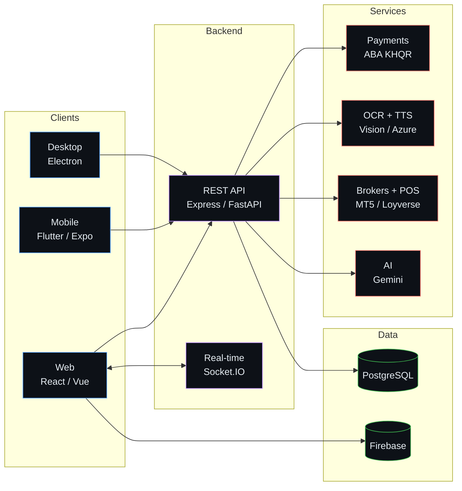
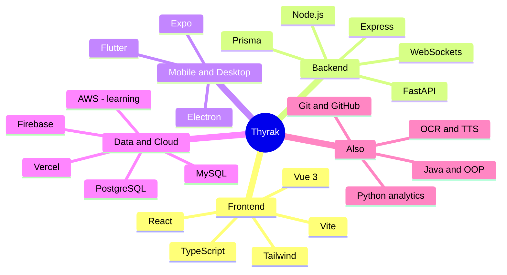

 

  

## About Me

<table>
  <tr>
    <td width="33%" valign="top">
      <h4>What I build</h4>
      Complete products, from database and API to web, mobile and desktop clients. Real-time ordering, digital leases, KHQR payments, OCR with text-to-speech, and trading analytics.
    </td>
    <td width="33%" valign="top">
      <h4>How I work</h4>
      Small steps, version control, and docs that let anyone pick the project back up. I use AI tools such as Claude Code as a pair programmer and keep every change reviewed and tested.
    </td>
    <td width="33%" valign="top">
      <h4>What is next</h4>
      Cloud computing, system design and deeper backend engineering. Every project I start is meant to be a bit harder than the last one.
    </td>
  </tr>
</table>

## Featured Projects

<table>
  <tr>
    <td width="42%" align="center" valign="middle">
      
    </td>
    <td width="58%" valign="top">
      <h3>HomeSweet</h3>
      Rental and real-estate platform for Phnom Penh, Cambodia.
      <ul>
        <li>Property search with an interactive map</li>
        <li>Rental applications and digital lease agreements</li>
        <li>ABA KHQR payments with PDF receipts</li>
        <li>Real-time chat and roommate matching</li>
        <li>360-degree virtual tours</li>
        <li>Camera-based identity verification</li>
      </ul>
      
      
       
      
      
      
    </td>
  </tr>
  <tr>
    <td width="42%" align="center" valign="middle">
      
    </td>
    <td width="58%" valign="top">
      <h3>songKHEM</h3>
      Accessibility app that reads Khmer documents aloud for blind and low-vision users.
      <ul>
        <li>Scan with the camera, an image or a multi-page PDF</li>
        <li>On-device OCR, or Google Cloud Vision for higher accuracy</li>
        <li>Azure neural voices with word-by-word highlighting</li>
        <li>Web app plus an Expo mobile app</li>
        <li>Serverless proxies keep API keys out of the browser</li>
      </ul>
      
      
       
      
      
      
      
    </td>
  </tr>
  <tr>
    <td width="42%" align="center" valign="middle">
      
    </td>
    <td width="58%" valign="top">
      <h3>Restaurant POS</h3>
      Ordering and point-of-sale platform for restaurants.
      <ul>
        <li>Customers order by scanning a table QR code</li>
        <li>Live order board and inventory for staff</li>
        <li>Flutter POS app for front-of-house</li>
        <li>Menu and order sync with Loyverse</li>
        <li>Instant updates to every device over WebSockets</li>
      </ul>
      
      
       
      
      
      
      
      
      
    </td>
  </tr>
  <tr>
    <td width="42%" align="center" valign="middle">
      
    </td>
    <td width="58%" valign="top">
      <h3>TradeLogger</h3>
      Personal trading journal and research platform. Read-only by design: it never places an order.
      <ul>
        <li>Syncs trades from MetaTrader 5 and Capital.com</li>
        <li>Performance analytics, risk sizing and price alerts</li>
        <li>Backtesting and strategy-discovery lab</li>
        <li>Read-only Gemini assistant for your own history</li>
        <li>Clients: web, Electron desktop and Expo mobile</li>
      </ul>
      
       
      
      
      
      
      
    </td>
  </tr>
</table>

## How My Projects Fit Together

Across these projects I keep reusing the same shape: several clients, one API, a database, and a few outside services.

<b>Open the skill map</b>

## Tech Stack

<table>
  <tr>
    <td width="18%"><b>Frontend</b></td>
    <td>
      
      
      
      
      
      
    </td>
  </tr>
  <tr>
    <td><b>Backend</b></td>
    <td>
      
      
      
      
      
      
      
    </td>
  </tr>
  <tr>
    <td><b>Mobile and Desktop</b></td>
    <td>
      
      
      
      
    </td>
  </tr>
  <tr>
    <td><b>Data and Cloud</b></td>
    <td>
      
      
      
      
      
    </td>
  </tr>
  <tr>
    <td><b>Tools</b></td>
    <td>
      
      
      
      
      
    </td>
  </tr>
</table>

## GitHub Stats

  
  
   
  

## GitHub Contribution

  <picture>
    <source media="(prefers-color-scheme: dark)" srcset="https://raw.githubusercontent.com/ThyrexGG/ThyrexGG/output/github-contribution-grid-snake-dark.svg" />
    <source media="(prefers-color-scheme: light)" srcset="https://raw.githubusercontent.com/ThyrexGG/ThyrexGG/output/github-contribution-grid-snake.svg" />
    
  </picture>

## Let's Build Something

